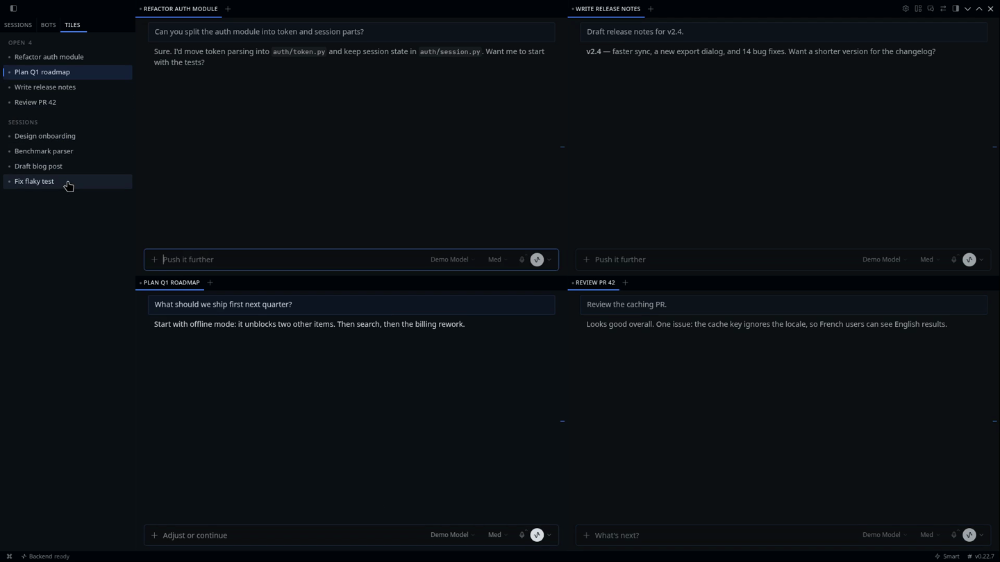

# Tiled Sessions

Hyprland-style tiling for Hermes Desktop. Click a session and it opens in a new tile next to the ones you already have, instead of replacing the chat you were in.



## What it does

- **Click opens a tile.** A click on a session opens it in a new pane. If that session is already on screen, its tile is focused; a session is never open twice.
- **Binary-tree tiling.** Each new tile splits an existing one along its longer side: side by side when it's wide, stacked when it's tall.
- **Two split targets** (`Settings → Tiled Sessions`):
  - `largest` (default): split the largest tile; on a tie, the most recently focused. 1 → 2 side by side → 1 + 2 stacked → an even 2×2 → …
  - `focused`: split the focused tile, like Hyprland's dwindle. Opening repeatedly makes a spiral.
- **Closing collapses the split.** The sibling takes the freed space.
- **A Tiles pane** in the sidebar: *Pinned*, then *Open* (tiles in on-screen order, the focused one highlighted, a close button on each row), then *Sessions*.
- **Keybinds**, all rebindable under `Settings → Keybinds`:

  | Action | Default |
  |---|---|
  | Move focus | `Mod+Alt+←/→/↑/↓` |
  | Swap with neighbour | `Mod+Alt+Shift+←/→/↑/↓` |
  | Close focused tile | `Mod+Alt+Backspace`, or Hermes' own `Ctrl+W` / `⌘W` |
  | Toggle the focused split's direction | `Mod+Alt+J` |
  | Equalize sizes | `Mod+Alt+=` |
  | Move the focused session to main | unbound |

- **Keyboard focus follows.** Moving focus moves the caret too, so what you type, and `Ctrl+W`, land in the focused tile. (Hermes' `Ctrl+W` acts on the tile under the pointer first, when the pointer is over one.)
- **Old behaviour on demand.** Hold `Alt` (configurable) while clicking to replace the focused chat, as stock Hermes does. You can also switch the default back to replace, and set a maximum tile count.
- **Survives a restart.** Hermes persists the pane tree, so tiles, the open set and split ratios come back as you left them.

## Requirements

Tiled Sessions uses the session-tiling seam of the desktop plugin SDK: `host.openSession(id, { dock })`, `host.state.sessionLayout`, `host.state.pinnedSessionIds` and `host.layout`. It is proposed upstream in [NousResearch/hermes-agent#149656](https://github.com/NousResearch/hermes-agent/pull/149656). On a Hermes build without it, the Tiles pane says so and sessions open as ordinary tabs.

It uses only the plugin SDK, React and `react/jsx-runtime`: no DOM queries, no observers, no patching. It makes no network calls of its own and sends no telemetry.

## Install

From the catalog:

```sh
hermes plugins install tiled-sessions
```

Or for development, copy `desktop/plugin.js` and `plugin.yaml` into `~/.hermes/desktop-plugins/tiled-sessions/` and restart the desktop app.

## Develop

```sh
npm test         # pure tiling engine: node --test
npm run build    # inline src/engine.mjs into desktop/plugin.js
npm run check    # build is current + syntax check
```

`src/engine.mjs` is the whole layout model (pick the split target, choose the edge, find neighbours, equalize) as pure functions over a small tree, tested without a browser. `src/plugin.src.mjs` maps it onto the SDK.

## License

MIT
