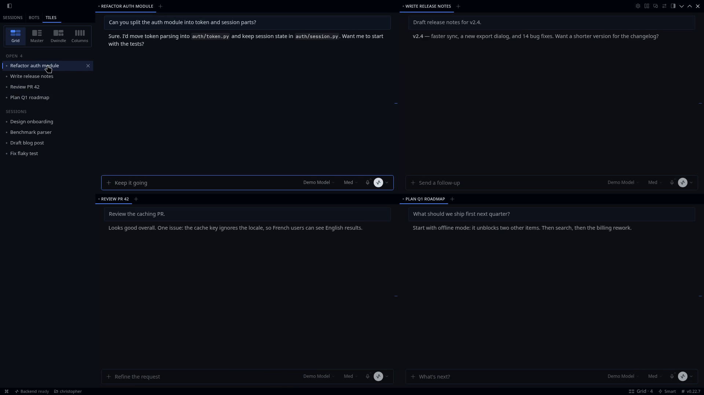
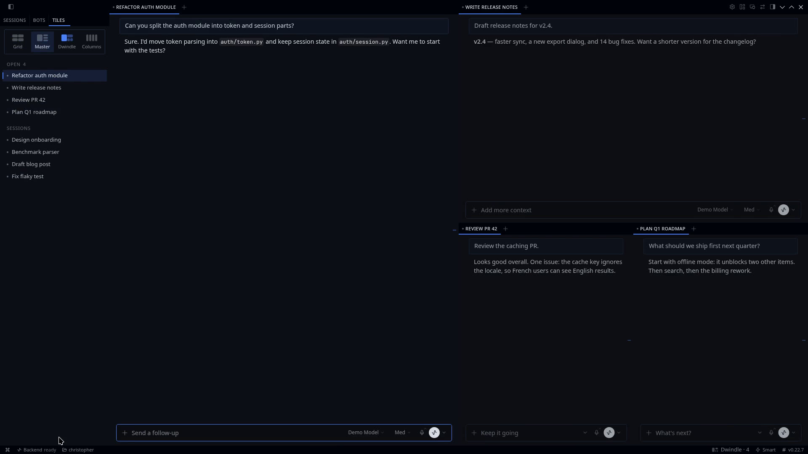
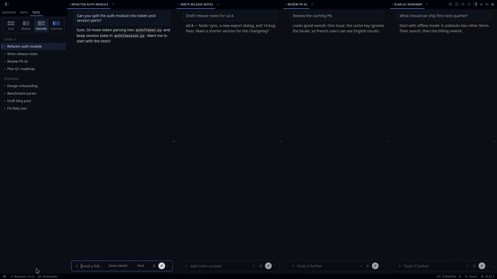
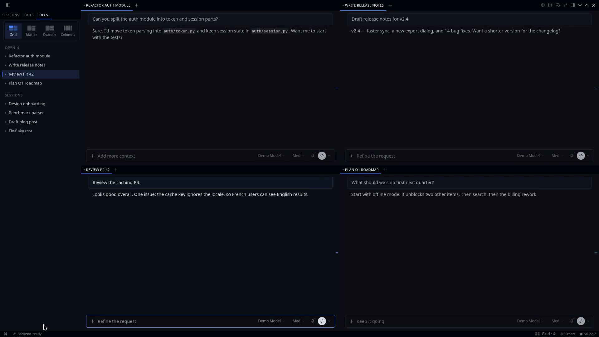
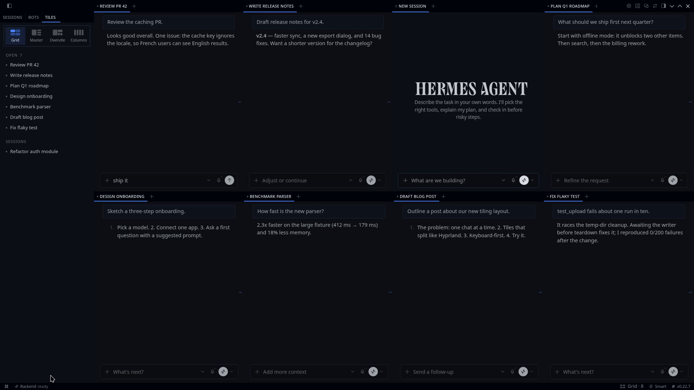
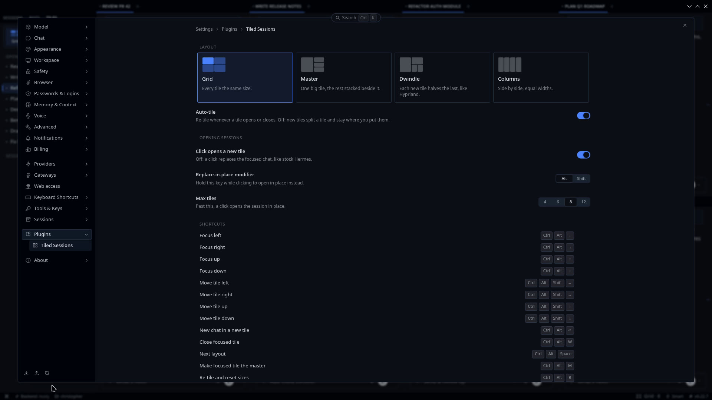

# Tiled Sessions

**Hyprland for Hermes Desktop.** Click a session and it opens as a new tile beside the ones you already have, instead of replacing the chat you were in. Pick a layout, drive it from the keyboard, and keep a whole team of agents on screen at once.

```sh
hermes plugins install tiled-sessions
```

[▶ Watch the 50-second demo](https://github.com/strnadchristopher/tiled-sessions/releases/download/v0.2.0/tiled-sessions-launch-720p.mp4)

| | | |
|---|---|---|
|  |  |  |
| **Grid** | **Master** | **Dwindle** |
|  |  |  |
| **Type where you focus** | **Eight at once** | **Every shortcut editable** |

## What it does

- **Click opens a tile.** A click on a session opens it in a new tile, and the layout re-tiles around it. If that session is already on screen, its tile is focused instead; a session is never open twice.
- **Four layouts**, switchable from the Tiles pane, the status bar chip, `Ctrl+Alt+Space`, or settings:

  | Layout | Behaviour |
  |---|---|
  | **Grid** (default) | Every tile the same size. 2 side by side, 3 in columns, 4 as a 2×2, 6 as a 3×2. |
  | **Master** | One big tile (50–66%, your pick) with the rest stacked evenly beside it. `Ctrl+Alt+M` makes the focused tile the master. |
  | **Dwindle** | Hyprland's default. Each new tile halves the last along its longer side, making a spiral. |
  | **Columns** | Side by side, equal widths. Made for ultrawides. |

- **Auto-tiling.** Whenever a tile opens or closes (by click, `Ctrl+W`, a tab's ✕ or a shortcut), every tile is laid out again. Dragging a sash to resize is left alone until the next open or close; `Ctrl+Alt+R` re-tiles on demand. You can turn auto-tiling off and place tiles yourself.
- **New chat in a new tile.** `Ctrl+Alt+Enter` starts a fresh chat in its own tile and focuses it, the way a tiling WM opens a terminal.
- **The keyboard follows focus.** Moving focus moves the caret too, so typing and `Ctrl+W` land in the focused tile. (Hermes' `Ctrl+W` acts on the tile under the pointer first, when the pointer is over one.)
- **A Tiles pane** in the sidebar: a layout switcher, then *Pinned*, then *Open* (tiles in on-screen order, focused one highlighted, a close button on each row), then *Sessions*.
- **Every shortcut is editable** right on the plugin's settings page (`Settings → Plugins → Tiled Sessions`), with the same recorder, conflict warnings and reset as `Settings → Keybinds`:

  | Action | Default |
  |---|---|
  | Move focus | `Ctrl+Alt+←/→/↑/↓` |
  | Move the focused tile | `Ctrl+Alt+Shift+←/→/↑/↓` |
  | New chat in a new tile | `Ctrl+Alt+Enter` |
  | Close the focused tile | `Ctrl+Alt+W`, or Hermes' own `Ctrl+W` / `⌘W` |
  | Next layout | `Ctrl+Alt+Space` |
  | Make the focused tile the master | `Ctrl+Alt+M` |
  | Re-tile and reset sizes | `Ctrl+Alt+R` |
  | Switch to Grid / Master / Dwindle / Columns | unbound |
  | Move the focused session to main | unbound |

  On GNOME, `Ctrl+Alt+←/→` may already switch workspaces; rebind either side if they clash.
- **Old behaviour on demand.** Hold `Alt` (configurable) while clicking to replace the focused chat, as stock Hermes does. You can also switch the default back to replace, and cap the number of tiles.
- **Survives a restart.** Hermes persists the pane tree and the plugin keeps tile order, so tiles, layout and sizes come back as you left them.

## Requirements

Tiled Sessions uses the session-tiling seam of the desktop plugin SDK: `host.openSession(id, { dock })`, `host.state.sessionLayout`, `host.state.pinnedSessionIds`, `host.layout` (including `arrangeSessions` and `newChatTile`) and `KeybindEditor`. It is proposed upstream in [NousResearch/hermes-agent#149656](https://github.com/NousResearch/hermes-agent/pull/149656). On a Hermes build without it, the Tiles pane says so and sessions open as ordinary tabs.

It uses only the plugin SDK, React and `react/jsx-runtime`: no DOM queries, no observers, no patching. It makes no network calls of its own and sends no telemetry.

## Install

In Hermes Desktop: **Capabilities → Plugins**, find **Tiled Sessions** in the catalog, or use **Install from Git** with `https://github.com/strnadchristopher/tiled-sessions`.

For development, copy `desktop/plugin.js` and `plugin.yaml` into `~/.hermes/desktop-plugins/tiled-sessions/`; the app hot-reloads it.

## Develop

```sh
npm test         # pure tiling engine: node --test
npm run build    # inline src/engine.mjs into desktop/plugin.js
npm run check    # build is current + syntax check
```

`src/engine.mjs` is the whole layout model (layouts, tile order, split targets, neighbours, equalize) as pure functions, tested without a browser. `src/plugin.src.mjs` maps it onto the SDK.

## License

MIT
